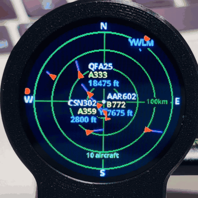
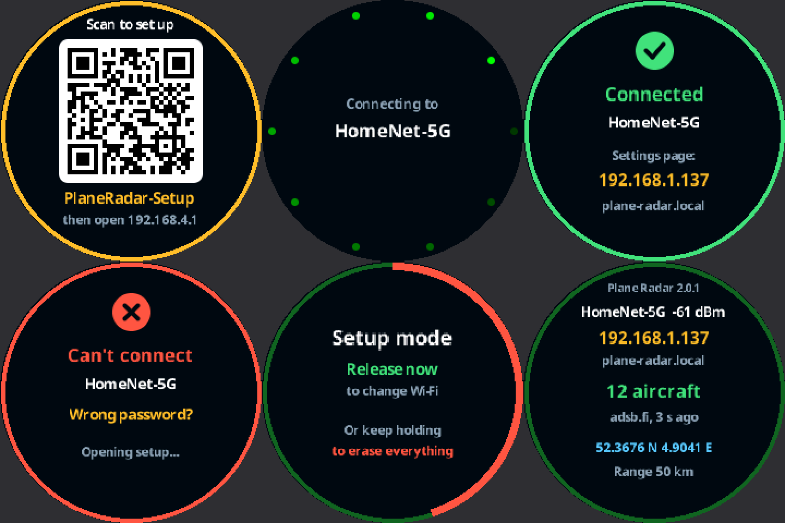
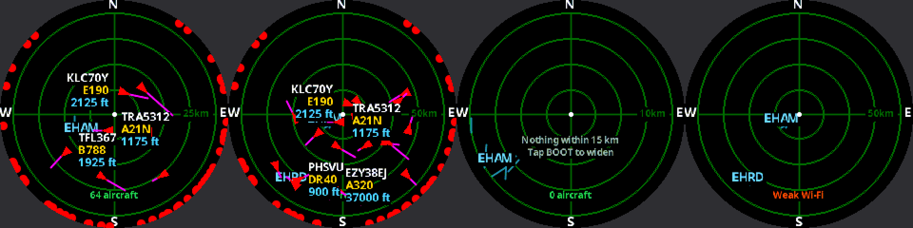

# Plane Radar v2

Firmware for an **ESP32-C3 Super Mini** with a **1.28″ round GC9A01** display (240×240): a live ADS-B radar centred on your location. This is a reworked copy of [MatixYo/ESP32-Plane-Radar](https://github.com/MatixYo/ESP32-Plane-Radar) — same hardware and wiring, new Wi-Fi setup, new settings page, and on-screen feed diagnostics.

<p align="center">
  
</p>

Screens rendered by the desktop simulator:




## Flash it

Download `plane-radar-v2.0.1.bin` from the [Releases](../../releases) page. It is a single merged image.

1. Open a web flasher such as [esptool-js](https://espressif.github.io/esptool-js/) in Chrome or Edge.
2. Put the board in download mode: hold **BOOT**, tap **RESET**, release BOOT.
3. Connect, choose the `.bin`, set the flash address to **`0x0`**, and program. Chip is ESP32-C3, 4 MB.
4. Press **RESET**.

If you don't erase the flash first, your Wi-Fi and location from the original firmware are kept.

## First run

1. The screen shows a QR code. Scan it with your phone to join the **`PlaneRadar-Setup`** network (or join it by hand). The settings page opens by itself; if it doesn't, browse to **`http://192.168.4.1`**.
2. Pick your Wi-Fi (2.4 GHz only), enter the password, press **Connect**.
3. The radar shows **Connected** with its address. From then on the settings page is at **`http://plane-radar.local`** or that address, from any device on the same Wi-Fi.
4. Set **Your location**. Until you do, the radar uses a rough estimate from your internet address, which can be a suburb or a whole city out.

## Seeing no aircraft?

The line under the centre of the radar tells you which case you're in:

| On screen | Meaning |
|---|---|
| `7 aircraft` | Feed is working; that many are in view. |
| `0 aircraft` + "Nothing within 37 km" | Feed is working, the sky near you is just empty. Tap **BOOT** for a wider range. |
| `Weak Wi-Fi` (red) | Updates are failing and the signal is below about -78 dBm. Move the radar closer to the router. |
| `Connect failed`, `Timed out`, `HTTP 4xx` … (red) | The feed can't be reached. |
| `Wi-Fi lost` (red) | Dropped off the network; it rejoins by itself. |

The settings page says the same in plain words, lists every aircraft with its distance and bearing, and has the raw numbers under **Connection details**.

If aircraft appear, then stop moving and vanish after about 45 seconds, the radar has stopped receiving updates. Weak Wi-Fi is the usual cause: every update is a fresh secure connection, which needs a reasonable signal. The info screen (hold BOOT about 1 s) shows the signal strength.

The original firmware defaulted to a 10 km ring centred on Amsterdam. Away from an airport there is often nothing airborne that close, so v2 defaults to a 50 km ring and goes out to 150 km.

## BOOT button

| Press | Does |
|---|---|
| Tap | Next range (5 · 10 · 15 · 25 · 50 · 100 · 150 km) |
| Hold about 1 s | Info screen: Wi-Fi, address, feed status, location |
| Hold 3 s, release | Setup mode (keeps your settings). Tap to cancel. |
| Keep holding 10 s | Erase everything |

## Settings page

- **Right now** — verdict, aircraft list, connection details
- **Wi-Fi** — scan, signal strength, change network
- **Your location** — type or paste coordinates, search a town, or estimate from your internet address
- **Radar display** — range, km/miles, number of labels, runways, aircraft on the ground, data source, Wi-Fi transmit power, red/blue swap
- **Device** — restart, erase

If aircraft show as blue rather than red, toggle **Swap red and blue**.

## What changed from v1

- Own captive portal instead of WiFiManager; QR code on the setup screen; clear connected / failed screens with the reason.
- Feed status on the radar, on the info screen and on the web page.
- Ranges up to 150 km. The feed reply is parsed one aircraft at a time, so wide ranges don't run out of memory; the nearest 64 are kept.
- Wi-Fi transmit power adapts to the signal: 8.5 dBm (kind to the Super Mini's antenna) when the router is close, up to 17 dBm when it is far.
- The settings page is served from its own task and gzipped, so a slow browser connection can't stall the radar.
- Falls back from adsb.fi to adsb.lol after repeated failures.
- Labels are limited to the nearest few and never overlap; symbols shrink when the screen is crowded.
- Aircraft vanish after 45 s without data instead of coasting forever.
- Dead-reckoning corrected for longitude away from the equator.
- Holding BOOT no longer wipes location and settings unless you keep holding.

## Tested board

Reported working on 2026-10-10 with this board (details from esptool-js):

- ESP32-C3 (QFN32), revision v0.4, 40 MHz crystal
- Embedded flash 4 MB (XMC), flash ID 164020
- Native USB serial, VendorID 0x303a / ProductID 0x1001
- Flashed with esptool-js at 921600 baud

## Wiring (unchanged)

| Display | ESP32-C3 |
|---------|----------|
| VCC | 3V3 |
| GND | GND |
| RST | GPIO 0 |
| CS | GPIO 1 |
| DC | GPIO 10 |
| SDA (MOSI) | GPIO 3 |
| SCL (SCLK) | GPIO 4 |
| BOOT (user) | GPIO 9 |

## Build

```bash
python3 -m venv .venv && .venv/bin/pip install platformio
.venv/bin/pio run                 # compile
./scripts/merge-firmware.sh       # writes release/plane-radar-v2.0.1.bin
.venv/bin/pio device monitor      # serial log, 115200 baud
```

On Apple Silicon without Rosetta, PlatformIO's `toolchain-riscv32-esp` is Intel-only. Replace the contents of `~/.platformio/packages/toolchain-riscv32-esp` with Espressif's `riscv32-esp-elf-gcc8_4_0-esp-2021r2-patch5-macos-arm64` release (keep `package.json`).

### Desktop tools (`sim/`)

| Command | What it does |
|---|---|
| `sim/render_screens.sh out feed.json` | Renders every device screen to PNG using the real UI code (needs SDL2). |
| `python3 sim/mock_device.py` | Fake device API for working on `data/portal.html`; open `http://localhost:8642/?scene=portal`. |
| `sim/feed_test.cpp` | Runs a captured feed reply through the firmware's parser. |

## Data and privacy

Aircraft data comes from [adsb.fi](https://opendata.adsb.fi/) and [adsb.lol](https://adsb.lol/); your coordinates are sent to them with each request. The first-run location estimate asks ip-api.com. Place search on the settings page runs in your browser against open-meteo.com. The settings page has no password: anyone on your Wi-Fi can open it.
